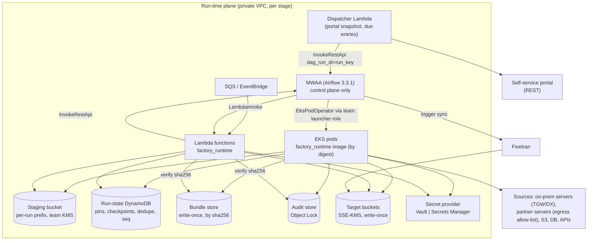

# Pipeline Factory v2: architecture overview

Status: **Phase 1 (proposed for review)**. This set of documents is the architecture for extending pipeline-factory 0.1.0
(the Fivetran Connector SDK factory in `src/pf`) into a multi-engine Pipeline Factory. Decisions are recorded as ADRs in
[`../adr/`](../adr/README.md). Phase 1 contains no product code.

## 1. What Pipeline Factory does

Teams describe an ingestion requirement in plain English. Pipeline Factory turns it into a **structured, validated
specification**. Deterministic generators then turn the spec into a deployable pipeline:

- **Runtime artefacts:** MWAA DAGs, EKS pod specs, Lambda functions and Fivetran connections.
- **Infrastructure:** Terraform and IAM.
- **Proof and records:** tests, documentation and a cost estimate.

People own the spec and every decision in it. Agents help write it and write the rare custom code. Everything after the
spec is deterministic and reproducible byte for byte.

```mermaid
flowchart LR
  BA["BA / data engineer<br/>(plain English)"] -->|factory author| INT["Intake agent<br/>(spec patches + open questions)"]
  INT --> SPEC["Spec<br/>(5 owner-scoped YAML files)"]
  SPEC --> VAL["Validator + planners<br/>(engine, dataflow, IAM, network, cost)"]
  VAL --> RI["Rule implementation<br/>(built-in op or custom plugin)"]
  RI --> RR["Rule review<br/>(separate context) + person acceptance"]
  RR --> GEN["Deterministic generators<br/>(Jinja, .tf.json)"]
  GEN --> TST["Tests<br/>(unit, integration, DAG integrity)"]
  TST --> IAC["Terraform plan + scans"]
  IAC --> PKG["Review package<br/>(spec, plan, tests, cost, docs)"]
  PKG -->|PR + CODEOWNERS| CI["CI deploy<br/>(OIDC, per team)"]
  CI --> RUN["AWS run-time plane"]
```

## 2. Three planes

| Plane | Where | Runs | Never has |
|---|---|---|---|
| **Build-time** | laptop / CI, in a toolchain image pinned by digest | `factory` CLI, spec models, validator, planners, generators, agents, orchestrator gates, `factory verify` | real data, AWS data-plane credentials |
| **Deploy** | CI (GitHub Actions, OIDC, per-team roles) | Terraform plan (PR) / apply (merge + approval); write-once bundle and Lambda zip; Fivetran via Terraform provider or `pf deploy`; hand-off to the **central DAG publisher** | write access to the MWAA bucket (only the publisher has it) |
| **Run-time** | private VPC per stage | MWAA (control only), EKS pods (heavy), Lambda (light, dispatch), SQS/EventBridge, staging bucket, run-state table, bundle store, audit store | LLM access; public endpoints |

## 3. Repositories

| Repository | Owner | Holds |
|---|---|---|
| **Framework** (this repo) | framework team | `pf` 0.1.0 (frozen) + the new packages (`factory_core`, `factory_spec`, `factory_runtime`, `factory_airflow`, `factory`), skills, the Claude Code plugin, starters, test stand-ins, docs |
| **Team pipelines** (one per team or isolation domain) | each team | `pipelines/<id>/spec/*.yaml`, `spec.lock.json`, committed custom rules, synthetic fixtures, approvals, change records, generated `build/` and workflows |
| **Platform** | platform team | shared Terraform modules (semver tags), live stacks per stage, MWAA `requirements.txt` / plugins / startup script, the central DAG publisher, `platform-settings/<stage>.json` (account model, placement, ARNs) |

Until org repositories exist, the team and platform content are kept as examples in this repo under
`examples/team-pipelines/` and `platform/` ([ADR-0002](../adr/0002-repository-topology.md)).

## 4. Document map

| Topic | Document | Key ADRs |
|---|---|---|
| Tech stack and version pins | [tech-stack.md](tech-stack.md) | 0001, 0007, 0017 |
| Repository and package layout | [repo-structure.md](repo-structure.md), [reuse.md](reuse.md) | 0001, 0002 |
| Spec | [spec-outline.md](spec-outline.md) | 0003 |
| Execution model, idempotency, logging | [execution-model.md](execution-model.md) | 0004, 0013, 0014, 0023 |
| Built-in operations and custom rules | [op-catalog.md](op-catalog.md) | 0004, 0020 |
| Engine selection | [engine-selection.md](engine-selection.md) | 0005 |
| MWAA environment strategy | [mwaa-strategy.md](mwaa-strategy.md) | 0006, 0007, 0010 |
| Secret provider | [secret-provider.md](secret-provider.md) | 0008, 0012 |
| Portal integration | [portal-integration.md](portal-integration.md) | 0009 |
| Security, network, multi-team, threat model | [security-network-multiteam.md](security-network-multiteam.md) | 0011, 0015, 0016, 0022 |
| Agents and gates | [agents-and-gates.md](agents-and-gates.md) | 0019, 0020, 0022 |
| Determinism and incremental change | [determinism-and-change.md](determinism-and-change.md) | 0017, 0018 |
| GxP / Part 11 / ALCOA+ | [gxp-validation.md](gxp-validation.md) | 0021 |
| Risks, spikes, open questions | [risk-register.md](risk-register.md), [spike-plan.md](spike-plan.md), [open-questions.md](open-questions.md) | — |
| Next phase | [phase-2-plan.md](phase-2-plan.md) | — |

## 5. Assumptions

| Id | Assumption | Confirmed by |
|---|---|---|
| A1 | MWAA runs **Airflow 3.3.1** (GA on MWAA Sep 2026). It is pinned only after the spike passes; **3.2** is the fallback. | spike S1 |
| A2 | One EKS cluster per stage, owned by the platform team. Karpenter provides on-demand and spot pools; each team gets a namespace. | Phase 1 review |
| A3 | Encryption defaults to the **AWS Encryption SDK** message format with a KMS keyring. `vault_kv`, `vault_transit` and `openpgp` are explicit options. | open question Q2 |
| A4 | MD5 exists only for consumers that ask for it. SHA-256 is always computed. | open question Q2 |
| A5 | The portal is an internal HTTPS JSON API whose contract is captured in the spec. | open question Q3 |
| A6 | This repo is the framework repo. Team and platform repos are represented under `examples/` and `platform/` for now. | Phase 1 review |
| A7 | Builds see synthetic data only. No AWS account, real Vault or real portal is available yet; AWS-only spikes wait for a sandbox. | open question Q5 |
| A8 | The Agent SDK can target Anthropic, Amazon Bedrock or Claude Platform on AWS. Replay keys use a logical model id. | ADR-0022 |
| A9 | The account model is not decided, so both models are supported (`shared_per_env`, `account_per_team`). | ADR-0015, Q6 |
| A10 | BAs work through the CLI / Claude Code first; a hosted UI later uses the same agent API. | user answer |
| A11 | Sources include on-prem servers (DX/VPN through a Transit Gateway) and external partners (controlled egress). SFTP, FTPS, HTTPS and S3 come first; SMB/NFS later. | user answer |

## 6. Corrections to the brief (raised for approval)

1. **Fivetran can run custom Python** through the Connector SDK (what pf 0.1.0 generates), but only to emit rows
   into a Fivetran destination. Packaging, encryption and object delivery never route to Fivetran. The matrix keeps
   two Fivetran engines ([ADR-0005](../adr/0005-engine-selection.md)).
2. **"Lambda < Fivetran < MWAA task < EKS pod" is a heuristic, not a law.** Fivetran is billed by MAR and MWAA has a
   fixed environment cost, so the planner compares per-task estimates instead.
3. **Airflow's AssetWatcher SQS trigger deletes the message when it fires** and can merge events into one run. That
   loses custody for GxP. Events go through a Lambda (or in-task custody transfer) instead
   ([ADR-0010](../adr/0010-event-triggers-and-sqs-custody.md)).
4. **No custom Airflow secrets backend.** MWAA's native Secrets Manager backend serves Airflow's own connections.
   Pipeline secrets never pass through Airflow ([ADR-0008](../adr/0008-secret-provider.md)).
5. **EKS Pod Identity is recommended over IRSA.** Both are generated; the default is decided at this review
   ([ADR-0011](../adr/0011-workload-identity.md)).
6. **Agent-generated tests are code.** They are reviewed and committed, never regenerated. BA-approved `test_cases`
   are the oracle ([ADR-0019](../adr/0019-agents-and-orchestrator.md)).
