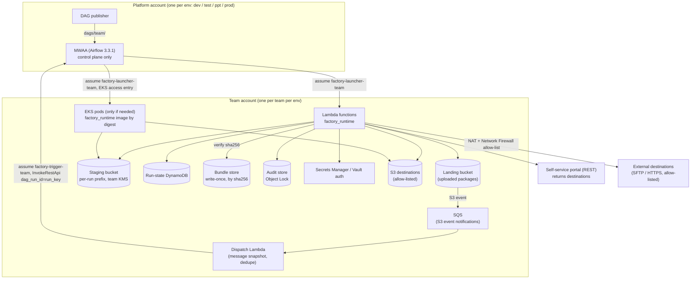

# Pipeline Factory v2: architecture overview

Status: **Accepted** (Phase 1 review, amended 2026-10-13). This set of documents is the architecture for extending pipeline-factory 0.1.0
(the Fivetran Connector SDK factory in `src/pf`) into a multi-engine Pipeline Factory. Decisions are recorded as ADRs in
[`../adr/`](../adr/README.md). Phase 1 (amended with the user decisions of 2026-10-13) contains no product code; Phase 2 adds the spec packages.

## 1. What Pipeline Factory does

Teams describe an ingestion requirement in plain English. Pipeline Factory turns it into a **structured, validated
specification**. Deterministic generators then turn the spec into a deployable pipeline:

- **Runtime artefacts:** MWAA DAGs, EKS pod specs, Lambda functions and Fivetran connections.
- **Infrastructure:** Terraform and IAM.
- **Proof and records:** tests, documentation and a cost estimate.

People own the spec and every decision in it. Agents help write it and write the rare custom code. Everything after the
spec is deterministic and reproducible byte for byte.

```mermaid
flowchart LR
  BA["BA / data engineer<br/>(plain English)"] -->|factory author| INT["Intake agent<br/>(spec patches + open questions)"]
  INT --> SPEC["Spec<br/>(5 owner-scoped YAML files)"]
  SPEC --> VAL["Validator + planners<br/>(engine, dataflow, IAM, network, cost)"]
  VAL --> RI["Rule implementation<br/>(built-in op or custom plugin)"]
  RI --> RR["Rule review<br/>(separate context) + person acceptance"]
  RR --> GEN["Deterministic generators<br/>(Jinja, .tf.json)"]
  GEN --> TST["Tests<br/>(unit, integration, DAG integrity)"]
  TST --> IAC["Terraform plan + scans"]
  IAC --> PKG["Review package<br/>(spec, plan, tests, cost, docs)"]
  PKG -->|PR + CODEOWNERS| CI["CI deploy<br/>(OIDC, per team)"]
  CI --> RUN["AWS run-time plane"]
```

## 2. Three planes and the account topology

**Account model** (user decision D7, [ADR-0015](../adr/0015-account-model.md)):
- Each team has **its own AWS account per environment: dev, test, ppt, prod**.
- A **platform account per environment** hosts the central MWAA (control plane only) and the DAG publisher.
- All data and data-plane compute stay in the team accounts: Lambda, EKS (only when needed), SQS, staging,
  run-state, bundles, secrets, KMS and targets.

| Plane | Where | Runs | Never has |
|---|---|---|---|
| **Build-time** | laptop / CI, in a toolchain image pinned by digest | `factory` CLI, spec models, validator, planners, generators, agents, orchestrator gates, `factory verify` | real data, AWS data-plane credentials |
| **Deploy** | CI (GitHub Actions, OIDC → per team-account deploy role) | Terraform plan (PR) / apply (merge + approval) into the team account; write-once bundle and Lambda zip; Fivetran via its REST API or `pf deploy`; hand-off to the **central DAG publisher** | write access to the MWAA bucket (only the publisher has it) |
| **Run-time** | platform account per env (MWAA) + team account per env (everything else), private networking | MWAA (control only); Lambda (light work, dispatch); EKS pods (heavy work, when needed); SQS; staging bucket; run-state table; bundle store; audit store | LLM access; public endpoints; team data in the platform account |

Cross-account roles ([ADR-0006](../adr/0006-mwaa-control-plane.md), [ADR-0010](../adr/0010-event-triggers-and-sqs-custody.md)):

| Role | Lives in | Assumed by | Can |
|---|---|---|---|
| `factory-launcher-<team>` | team account | platform MWAA execution role (trust + ExternalId) | invoke the team's `factory-*` Lambdas; create pods in the team EKS namespace (access entry) |
| `factory-trigger-<team>` | platform account | the team's dispatch Lambda role | `airflow:InvokeRestApi` as the team's Airflow RBAC role (team DAGs only) |
| `factory-<pipeline>-<task>` workload roles | team account | Lambda / EKS Pod Identity | exactly the actions derived from the task's ops on declared resources |
| `factory-deploy-<team>` | team account | GitHub OIDC (team repo + environment) | Terraform for the team's pipeline stacks; write-once bundles |

## 3. Repositories

| Repository | Owner | Holds |
|---|---|---|
| **Framework** (this repo) | framework team | `pf` 0.1.0 (frozen) + the new packages (`factory_core`, `factory_spec`, `factory_runtime`, `factory_airflow`, `factory`), skills, the Claude Code plugin, starters, test stand-ins, docs |
| **Team pipelines** (one per team or isolation domain) | each team | `pipelines/<id>/spec/*.yaml`, `spec.lock.json`, committed custom rules, synthetic fixtures, approvals, change records, generated `build/` and workflows |
| **Platform** | platform team | shared Terraform modules (semver tags), live stacks per stage, MWAA `requirements.txt` / plugins / startup script, the central DAG publisher, `platform-settings/<stage>.json` (account model, placement, ARNs) |

Until org repositories exist, the team and platform content are kept as examples in this repo under
`examples/team-pipelines/` and `platform/` ([ADR-0002](../adr/0002-repository-topology.md)).

## 4. Document map

| Topic | Document | Key ADRs |
|---|---|---|
| Tech stack and version pins | [tech-stack.md](tech-stack.md) | 0001, 0007, 0017 |
| Repository and package layout | [repo-structure.md](repo-structure.md), [reuse.md](reuse.md) | 0001, 0002 |
| Spec | [spec-outline.md](spec-outline.md) | 0003 |
| Execution model, idempotency, logging | [execution-model.md](execution-model.md) | 0004, 0013, 0014, 0023 |
| Built-in operations and custom rules | [op-catalog.md](op-catalog.md) | 0004, 0020 |
| Engine selection | [engine-selection.md](engine-selection.md) | 0005 |
| MWAA environment strategy | [mwaa-strategy.md](mwaa-strategy.md) | 0006, 0007, 0010 |
| Secret provider | [secret-provider.md](secret-provider.md) | 0008, 0012 |
| Portal integration and destinations | [portal-integration.md](portal-integration.md) | 0009, 0024 |
| Security, network, multi-team, threat model | [security-network-multiteam.md](security-network-multiteam.md) | 0011, 0015, 0016, 0022 |
| Agents and gates | [agents-and-gates.md](agents-and-gates.md) | 0019, 0020, 0022 |
| Determinism and incremental change | [determinism-and-change.md](determinism-and-change.md) | 0017, 0018 |
| GxP / Part 11 / ALCOA+ | [gxp-validation.md](gxp-validation.md) | 0021 |
| Risks, spikes, open questions | [risk-register.md](risk-register.md), [spike-plan.md](spike-plan.md), [open-questions.md](open-questions.md) | — |
| Phase 2 design | [phase-2-design.md](phase-2-design.md) | 0003, 0024 |

## 5. Assumptions and user decisions

Decisions D1–D10 were made by the user on 2026-10-13. Assumptions still open are marked.

| Id | Statement | Status |
|---|---|---|
| A1 | MWAA runs **Airflow 3.3.1** (GA on MWAA Sep 2026), pinned after spike S1; **3.2** is the fallback. | assumption (spike S1) |
| D7 | Each team has its own AWS account per environment: **dev, test, ppt, prod**. A platform account per environment hosts the central MWAA; data and compute stay in team accounts. | decided |
| A2 | EKS clusters live in team accounts and are provisioned per team-env **only when a pipeline needs pods** (Karpenter; on-demand + spot). | design |
| D3 | **Package encryption is done outside the pipeline for now.** `encrypt` / `crypto.*` stay in the schema as *planned*. At-rest encryption is SSE-KMS and transit is TLS. | decided |
| A4 | MD5 is produced for consumers that ask for it and is computed over the zip. SHA-256 is always computed. | design |
| D1 | The SQS message carries metadata of a package uploaded to S3 (bucket, prefix, …); the run downloads all objects under that prefix. | decided |
| D2 | The portal returns the **destinations**: another S3 bucket/prefix or an external server (SFTP, HTTPS, more later). Only allow-listed destinations are accepted ([ADR-0024](../adr/0024-portal-resolved-destinations.md)). | decided |
| D4 | Portal changes take effect immediately (no PR gate). | decided |
| D5 | GitHub PR approvals (SSO identities) are accepted as Part 11 e-signatures. | decided |
| D6 | No AWS sandbox until the framework is complete. Phases 2–7 are verified locally; AWS-only spikes run in **Phase 8**. | decided |
| D8 | Workload identity: **EKS Pod Identity** by default (IRSA supported); per-pipeline workload roles. | decided by us (user unsure) |
| D9 | Fivetran is SaaS. Native connectors are managed through the Fivetran REST API; the Terraform provider is optional later. | decided |
| D10 | Max package per run: **10 GB**. | decided |
| A6 | This repo is the framework repo. Team and platform repos are represented under `examples/` and `platform/` for now. | design |
| A8 | The Agent SDK can target Anthropic, Amazon Bedrock or Claude Platform on AWS. Replay keys use a logical model id. | design |
| A10 | BAs work through the CLI / Claude Code first; a hosted UI later uses the same agent API. | user answer |
| A11 | Sources include S3, on-prem servers (DX/VPN through a Transit Gateway) and external partners (controlled egress). | user answer |

## 6. Corrections to the brief (accepted at the Phase 1 review)

1. **Fivetran can run custom Python** through the Connector SDK, but only to emit rows into a Fivetran
   destination. Packaging and object delivery never route to Fivetran
   ([ADR-0005](../adr/0005-engine-selection.md)).
2. **"Lambda < Fivetran < MWAA task < EKS pod" is a heuristic.** The planner compares per-task estimates.
3. **Airflow's AssetWatcher SQS trigger deletes the message when it fires** and can merge events. Events go
   through a dispatch Lambda instead ([ADR-0010](../adr/0010-event-triggers-and-sqs-custody.md)).
4. **No custom Airflow secrets backend.** MWAA's native Secrets Manager backend serves Airflow's own connections.
   Pipeline secrets never pass through Airflow ([ADR-0008](../adr/0008-secret-provider.md)).
5. **EKS Pod Identity is the default** instead of IRSA; both are generated
   ([ADR-0011](../adr/0011-workload-identity.md)).
6. **Agent-generated tests are code.** They are reviewed and committed, never regenerated. BA-approved
   `test_cases` are the oracle ([ADR-0019](../adr/0019-agents-and-orchestrator.md)).
7. **Portal-supplied destinations are constrained by a reviewed allow-list.** The portal is trusted to *choose*,
   not to *define*, where data may go ([ADR-0024](../adr/0024-portal-resolved-destinations.md)).

## 7. Delivery phases

| Phase | Content | Status |
|---|---|---|
| 1 | Architecture, ADRs, repo skeleton | done; amended with D1–D10 |
| 2 | Spec models, JSON Schema, starters, worked example, validator tests ([design](phase-2-design.md), [as built](phase-2-design.md#i-as-built-differences-from-this-design-and-why)) | done |
| 3 | Runtime op library, secret provider, portal client, plugin interface ([design](phase-3-design.md)) | done |
| 4 | Agents, orchestrator, gates, skills ([design](phase-4-design.md)) | done (live recordings pending an API key) |
| 5 | Generators (DAG, Lambda, EKS, Fivetran) and Terraform/IAM ([design](phase-5-design.md)) | done |
| 6 | Change engine, `factory verify`, cost, docs ([design](phase-6-design.md)) | done |
| 7 | Local end-to-end demo + incremental changes ([design](phase-7-design.md), [demo](../demo.md)) | done |
| CR1 | Bring-your-own infrastructure, local secrets, local runs, services by configuration ([design](change-request-1.md)) | done; awaiting review |
| 8 | **AWS validation in a sandbox account** (spikes S2, S3, S5, S9, S10; real MWAA/EKS/Lambda run) ([design](phase-8-design.md), [runbook](../sandbox-runbook.md)) | part A done; part B blocked on sandbox credentials |
