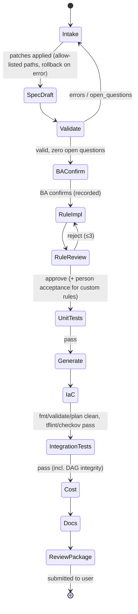

# Agents, orchestrator and gates

Decision records: [ADR-0019](../adr/0019-agents-and-orchestrator.md),
[ADR-0020](../adr/0020-custom-rule-plugins.md), [ADR-0022](../adr/0022-llm-boundary.md).

## 1. Principle: LLMs author, code decides

LLMs are used where judgement on plain English is needed:
- turning requirements into spec patches;
- mapping rules to ops;
- writing the rare custom plugin;
- independent review;
- extra edge-case tests;
- turning a change request into a patch.

Everything that decides whether work proceeds is **deterministic code**:
- validation, planning, generation;
- tests, scans;
- cost, change planning, docs;
- the orchestrator's gates.

The LLM never grades its own work.

| Agent (brief §5.1) | Kind | Skill | Input → output (Pydantic) |
|---|---|---|---|
| 1 Intake / Spec Author | **LLM**, interactive | `spec-authoring` | `IntakeTurn(spec_view, section, ba_message)` → `IntakeResult(patches[], explanations[], open_questions[], next_section)` |
| 2 Spec Validator | **code** (LLM only phrases fix hints) | — | `PipelineSpec` → `ValidationReport(issues[{code, file, path, severity, message, fix_hint}])` |
| 3 Rule Implementation | **LLM** | `rule-implementation` | `RuleImplRequest(rule, op_catalog_view, contract_stub)` → `RuleImplResult(builtin{op, params} \| custom{code, tests, side_effects, aws_actions}, rationale)` |
| 4 Rule Review | **LLM**, separate context + **code** checks | `rule-review` | `ReviewRequest(rule.plain_english, contract, code, tests, check_results)` → `ReviewVerdict(approve\|reject, findings[{severity, category, line, message}])` |
| 5 Test | **code** runs; **LLM** adds edge cases only | `test-generation` | `TestGenRequest(contract, ba_test_cases)` → `TestGenResult(extra_cases[])`; runner → `TestReport` |
| 6 Code Generator | **code** (Jinja) | — | `spec.lock` → files + `BUILD-MANIFEST` |
| 7 IaC | **code** (generator + fmt/validate/plan/tflint/checkov) | `terraform-review` (optional explanations) | `spec.lock` + `platform-settings` → `.tf.json` + `PlanSummary` |
| 8 Documentation | **code** | — | lock + reports → docs |
| 9 Change | **LLM** for intake of the request + **code** planner | `change-intake` | `ChangeRequest(text)` → `ChangeIntakeResult(patches[])` → `ChangePlan` |
| 10 Cost | **code** (LLM suggestions optional, never gating) | — | lock + pricing → `CostEstimate(per_run, per_month, by_engine, vs_budget, suggestions[])` |
| 11 Orchestrator | **code** state machine | — | runs everything, enforces gates → `ReviewPackage` or `Escalation` |

## 2. AgentRunner (generalised from `pf/llm/agent_sdk.py`)

- **One isolated session per call.**
  - `setting_sources=[]` (no CLAUDE.md or user settings);
  - `strict_mcp_config=True` with no MCP servers unless the agent declares in-process SDK tools;
  - `disallowed_tools=["Agent","Task","mcp__*"]`;
  - only the agent's skill (from the framework's headless skills plugin) plus `StructuredOutput`;
  - `permission_mode="dontAsk"`;
  - a PreToolUse hook denies anything else.
- **Parameters per agent:** skill, allowed tools, output schema (`strict_schema` from pf), system prompt, budget
  (USD), max turns, timeout and model.
- **Checks:** the tool list at session start must equal the declared list; the answer counts only if the skill
  loaded successfully; output is validated again with Pydantic.
- **Determinism:**
  - **record/replay** (pf mechanism);
  - the replay key = sha256(task, skill name + content hash, prompt, schema, prompt version, **logical model id**);
  - recordings carry provenance (provider, provider model id, cost, turns) and an output hash, so tampering is
    detected.
- **No access:** no file-system tools, network or AWS credentials. Everything an agent needs is in the prompt, and
  everything it returns is a typed object.

## 3. Bounded self-correction

```
attempt = 1
loop:
  result = agent(request)                      # typed
  issues = deterministic_checks(result)        # validator / tests / scanners, structured
  if not issues: accept
  if attempt == 3 or signature(issues) == previous_signature or budget_exceeded: escalate
  request = request.with_feedback(issues)      # only structured issues, never free text from another agent
  attempt += 1
```

`Escalation{agent, attempts, last_issues[], budget_used, artefacts, recommended_human_action}` is shown to the user
and written to the audit trail.

## 4. Gates (brief §6) and the review package



The orchestrator submits **only when all of these hold**:
- the spec is valid with zero `open_questions`;
- every custom rule has an `approve` verdict **and** a person's acceptance digest matching its code;
- every test passes;
- Terraform validate and plan are clean and the scans pass (or findings are waived in a reviewed waiver file);
- the cost is within budget, or the overrun is explicitly flagged;
- the docs are generated.

The **review package** (`build/review/`, deterministic) contains:
- the spec view;
- the artefact summary (`BUILD-MANIFEST` diff);
- test results;
- the Terraform plan summary (adds, changes, destroys; replaces flagged);
- the cost estimate;
- review records and acceptances;
- links to the docs.

## 5. Skills (each with a `SKILL.md`)

| Skill | Used by | Holds |
|---|---|---|
| `spec-authoring` | Intake | how to ask one topic at a time, section explanations in plain English, the allowed patch paths, the never-fill list (governance, security, infrastructure identities) |
| `rule-implementation` | Rule Implementation | the op catalog view, how to prefer built-ins, the plugin contract, test expectations |
| `rule-review` | Rule Review | the review checklist: intent match, correctness, security (egress, secrets, file I/O), idempotency, cost, determinism |
| `test-generation` | Test | edge-case heuristics (empty, huge, unicode paths, duplicates, boundary sizes); no oracle changes |
| `terraform-review` | IaC (optional) | explaining plan deltas to a person |
| `change-intake` | Change | mapping a change request to spec patches; never editing generated files |

**Headless vs interactive.** Headless skills live in a separate plugin loaded only by `factory` (the pf
`steps-plugin` pattern). The interactive Claude Code plugin (for BAs and engineers) provides:
- skills that drive `factory --json`;
- a read-only spec-reviewer agent;
- fail-closed hooks that deny edits to generated files, person-only commands (`factory accept`, deploy) and secret
  reads (the pf `hooks.py` pattern).

## 6. Audit of agent decisions

Every agent call appends to `pipelines/<id>/audit/agent-decisions.jsonl`:
`{ts, agent, skill_sha, model (logical + provider id), prompt_sha, schema_sha, output_sha, verdict/patch summary,
attempt, cost_usd, actor (person driving the session)}`. The file is committed with the change, so it is reviewed in
the PR.
