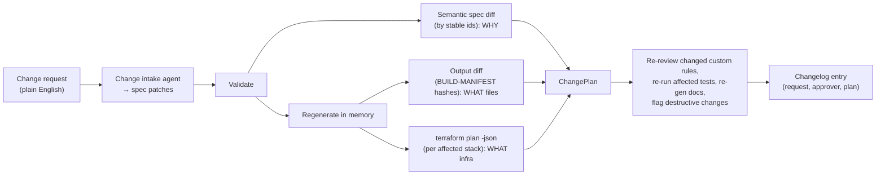

# Determinism and incremental change

Decision records: [ADR-0017](../adr/0017-determinism.md), [ADR-0018](../adr/0018-change-engine.md).

## 1. Idempotent generation

**Requirement:** the same spec, on any machine, any number of times, produces byte-identical output.

| Control | How |
|---|---|
| Canonical input | `spec.lock.json`: merged, normalised spec (defaults filled in, short forms expanded), serialised with `canonical()` (sorted keys, compact, UTF-8; from pf `lock.py`) |
| Build hash | sha256 of `{logic_sha, binding_shas, generator_version, template_tree_sha, op_contract_shas, engine_table_sha, pricing_sha, toolchain_lock_sha, custom_rule_shas}` → `BUILD-MANIFEST.json` together with the sha256 of every file |
| Pinned toolchain | `factory generate` / `verify` run in the **toolchain image by digest**. `toolchain.lock.json` pins Python, pydantic, jinja2, ruamel, Terraform + providers (multi-platform lock hashes), tflint, checkov, the MWAA constraints URL + hash, and the runtime image digests. |
| No ambient values | no timestamps, random ids, absolute paths, hostnames, usernames or environment variables in output; `now()` is never called by generators |
| Template rules | Jinja `StrictUndefined`; no iteration over sets or unordered dicts; `PurePosixPath`; LF line endings; a trailing newline; fixed zip metadata (from pf `release._zip`) |
| Terraform | per-pipeline stacks as canonical **`.tf.json`** (no escaping and no dependence on `terraform fmt`); shared modules stay hand-written HCL in the platform repo |
| No per-file version stamps | unlike pf 0.1.0 headers, generated files carry no framework version or spec hash; those live only in `BUILD-MANIFEST`. A framework upgrade that changes nothing produces zero diff. |
| Dependencies | `factory deps lock` resolves and hashes each target's dependencies (pod image, Lambda, MWAA against its constraints). It is run deliberately and its output committed. `generate` never touches the network. |
| LLM output | custom rule code, tests and review records are committed under `rules/<id>/`, keyed by `sha256(contract + plain_english + test_cases)`. If the key is unchanged they are reused and never re-prompted. |
| Proof | `factory verify` regenerates in memory and diffs against the committed output (building on pf `generate.check`), reporting missing, differing and unexpected files. CI fails on any drift. The cross-platform check runs on Linux and macOS. |

## 2. Incremental change

- **The *what* comes from outputs, not from predicting impact from inputs.** Regeneration is cheap and exact. The
  change set is the files whose hashes changed, plus the Terraform resources in the plan. The semantic diff (rule
  added, op param changed, target prefix changed …) explains *why*.
- **ChangePlan** = `{spec_changes[], files{added, changed, removed}, rules_to_review[], tests_to_run[], tf{create,
  update, replace, destroy}, dag_strategy, docs_to_regen[], requires_approval[]}`.
- **Only the affected pieces are re-done:**
  - custom rules whose key changed are re-reviewed and re-accepted;
  - tests run for affected rules, tasks and DAGs (plus the DAG integrity suite);
  - docs are regenerated wholesale, and because they are deterministic only changed pages differ.
- **Destructive changes.**
  - `replace` or `destroy` of stateful resources (buckets, KMS keys, tables, log groups, Object Lock settings) needs
    explicit approval.
  - Shared modules use `prevent_destroy`.
  - Renames of stable ids generate `moved` blocks.
- **DAG safety:**
  - non-breaking changes keep the `dag_id` (run pinning protects in-flight runs);
  - changes to task-graph shape or `run_key` semantics bump the spec's major version and create
    `<pipeline>__v<major>`;
  - the old DAG is paused, drained and retired.
- **Changelog:** `changes/<n>.json` records the request text, the patches, the ChangePlan hash, approvers (from the
  PR) and the resulting `spec_version`. Docs render the history.
