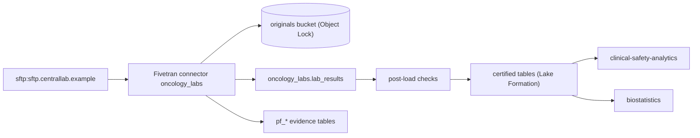

# Oncology central-lab results (vendor SFTP) (`oncology_labs` v1.0.0)

Land central-lab results for oncology studies daily so safety and efficacy analytics use one trusted copy.

- Owners: product @rd-oncology-po · engineering @rd-data-eng · governance @rd-data-governance · quality @rd-data-quality
- GxP tier: gxp_indirect · freshness SLA: 24 h · consumers: clinical-safety-analytics, biostatistics
- Source: sftp → Fivetran Connector SDK (`oncology_labs`) → S3 lake (Iceberg), schema `oncology_labs`
- Spec sha256: `b956e99048976c16be5c13bcde9d499a703f4d154972e670de4adf63bfa22fb5`

## Lineage

## Source-to-target mapping

### lab_results — One lab test result per subject, visit and test

Source: `^lab_results_\d{3}\.csv$` · load: upsert · key: subject_key, visit, test_code

| Source column | Transforms | Target | Type | Null | Classification | Checks | Business rule |
|---|---|---|---|---|---|---|---|
| `SUBJID` | trim, pseudonymise | `subject_key` | STRING | no | restricted | — | The vendor subject id is never stored in clear |
| `SITEID` | trim, pad_left | `site_id` | STRING | no | internal | site_id_format | — |
| `VISIT` | — | `visit` | INT | no | confidential | visit_range | — |
| `VISITDT` | — | `visit_date` | NAIVE_DATE | no | confidential | — | — |
| `RCVDT` | — | `received_date` | NAIVE_DATE | no | confidential | — | — |
| `LBTESTCD` | trim, upper | `test_code` | STRING | no | confidential | test_code_known | — |
| `LBORRES` | — | `result_value` | DECIMAL(18,6) | yes | confidential | — | — |
| `LBORRESU` | — | `result_unit` | STRING | yes | confidential | — | — |

## Checks

| Id | Where | Kind | On fail | Mode | Intent |
|---|---|---|---|---|---|
| package_not_empty | package | not_empty | reject_package | enforce | A delivery with no bytes is a broken source |
| package_size | package | file_size | reject_package | enforce | Delivery size within agreed bounds |
| package_not_duplicate | package | duplicate_package | reject_package | enforce | The same file content is never loaded twice |
| package_name | package | file_name_pattern | reject_package | enforce | File names follow LB_<study>_<seq>.zip |
| package_checksum | package | checksum | reject_package | enforce | Content matches the vendor's SHA-256 sidecar |
| package_is_zip | package | package_type | reject_package | enforce | Deliveries are zip archives |
| package_folder | package | folder_structure | reject_package | enforce | Deliveries sit in a YYYYMMDD folder |
| package_members | package | required_members | reject_package | enforce | Each delivery has lab results and a control file |
| package_no_executables | package | forbidden_members | reject_package | enforce | No executable content |
| package_member_count | package | member_count | reject_package | enforce | Between 2 and 20 files per delivery |
| lab_results_has_rows | lab_results | row_count | reject_package | enforce | Every delivery has lab results |
| lab_results_unique | lab_results | unique | reject_package | enforce | One result per subject, visit and test in a delivery |
| lab_results_control_count | lab_results | control_count | reject_package | enforce | Row count matches the vendor control file |
| result_has_unit | lab_results (row) | expression | quarantine_row | enforce | A result always has a unit |
| visit_before_receipt | lab_results (row) | english | quarantine_row | enforce | Samples cannot be received before the visit |
| site_id_format | lab_results.site_id | regex | quarantine_row | enforce | Site ids are 4 digits |
| visit_range | lab_results.visit | range | quarantine_row | enforce | Visits are numbered 1-99 |
| test_code_known | lab_results.test_code | allowed_values | quarantine_row | enforce | Only tests in the lab manual |
| lab_results_lake_rows | lab_results (lake) | row_count | blocker | enforce | lab_results is not empty |
| lab_results_lake_unique | lab_results (lake) | unique | blocker | enforce | One row per subject, visit and test across all deliveries |
| lab_results_fresh | lab_results (lake) | freshness | warning | enforce | Synced within the SLA |
| lab_results_reconciled | lab_results (lake) | reconciliation | blocker | enforce | Every lake row comes from a loaded delivery |

## Evidence tables

`pf_package_audit` (one row per delivery per run), `pf_entity_audit` (rows read/emitted/quarantined per entity),
`pf_rule_results` (every rule, evaluated and failed counts), `pf_quarantine` (row numbers and rule ids, never values).
