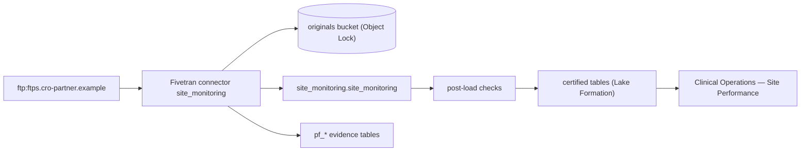

# Site monitoring visit reports (CRO FTPS feed) (`site_monitoring` v0.1.0)

Give clinical operations a daily view of monitoring visits and open issues per investigator site, so that overdue sites are escalated within one business day.

- Owners: product @clinops-po · engineering @rd-data-eng · governance @rd-governance · quality @rd-data-quality
- GxP tier: non_gxp · freshness SLA: 24 h · consumers: Clinical Operations — Site Performance
- Source: ftp → Fivetran Connector SDK (`site_monitoring`) → S3 lake (Iceberg), schema `site_monitoring`
- Spec sha256: `1004b23181f78f73e71900d2afacb9d42cc368a4db4d9ddd74f37a5f01a1bc53`

## Lineage

## Source-to-target mapping

### site_monitoring — One row per monitoring visit from the CRO daily CSV

Source: `SMV_\d{8}_\d{2}\.csv` · load: upsert · key: visit_id

| Source column | Transforms | Target | Type | Null | Classification | Checks | Business rule |
|---|---|---|---|---|---|---|---|
| `VISIT_ID` | — | `visit_id` | STRING | no | internal | — | unique, mandatory |
| `SITE_NO` | — | `site_no` | STRING | no | internal | site_no_format | mandatory, 4 digits |
| `STUDY` | — | `study` | STRING | no | internal | — | mandatory |
| `VISIT_TYPE` | — | `visit_type` | STRING | no | internal | visit_type_values | SIV, IMV, COV (initiation, interim, close-out) |
| `VISIT_DATE` | — | `visit_date` | NAIVE_DATE | no | internal | — | mandatory |
| `REPORT_DATE` | — | `report_date` | NAIVE_DATE | yes | internal | — | optional until finalised |
| `OPEN_ISSUES` | — | `open_issues` | INT | yes | internal | open_issues_non_negative | whole number, zero or more |
| `CRA_EMAIL` | — | `cra_email` | STRING | yes | confidential | — | personal data |

## Checks

| Id | Where | Kind | On fail | Mode | Intent |
|---|---|---|---|---|---|
| package_not_empty | package | not_empty | reject_package | enforce | A delivery with no bytes is a broken source |
| package_size | package | file_size | reject_package | enforce | Delivery size within agreed bounds |
| package_not_duplicate | package | duplicate_package | reject_package | enforce | The same file content is never loaded twice |
| package_name | package | file_name_pattern | reject_package | enforce | File names follow the agreed naming convention |
| site_monitoring_has_rows | site_monitoring | row_count | reject_package | enforce | Every delivery of site_monitoring has rows |
| report_within_10_days | site_monitoring (row) | english | quarantine_row | enforce | A report must be finalised no more than 10 calendar days after the visit date. |
| cov_zero_open_issues | site_monitoring (row) | english | quarantine_row | enforce | Close-out visits (COV) must have zero open issues. |
| site_no_format | site_monitoring.site_no | regex | quarantine_row | enforce | Site numbers are 4 digits |
| visit_type_values | site_monitoring.visit_type | allowed_values | quarantine_row | enforce | Visit type must be SIV, IMV or COV |
| open_issues_non_negative | site_monitoring.open_issues | range | quarantine_row | enforce | Open issues can never be negative |
| site_monitoring_lake_rows | site_monitoring (lake) | row_count | blocker | enforce | site_monitoring is not empty |
| site_monitoring_fresh | site_monitoring (lake) | freshness | warning | enforce | site_monitoring synced within the SLA |
| site_monitoring_reconciled | site_monitoring (lake) | reconciliation | blocker | enforce | Lake rows equal rows the connector emitted |

## Evidence tables

`pf_package_audit` (one row per delivery per run), `pf_entity_audit` (rows read/emitted/quarantined per entity),
`pf_rule_results` (every rule, evaluated and failed counts), `pf_quarantine` (row numbers and rule ids, never values).
