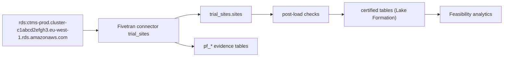

# Investigator sites from CTMS (`trial_sites` v0.1.0)

Provide the current list of investigator sites for feasibility analytics.

- Owners: product @feasibility-po · engineering @rd-data-eng · governance @rd-governance · quality @rd-data-quality
- GxP tier: non_gxp · freshness SLA: 24 h · consumers: Feasibility analytics
- Source: rds → Fivetran Connector SDK (`trial_sites`) → S3 lake (Iceberg), schema `trial_sites`
- Spec sha256: `d4cafee52eb723d9949a28dedb44a73859abb183165221e79b46c4c3d240642a`

## Lineage

## Source-to-target mapping

### sites — Investigator sites from CTMS

Source: `clinical.sites` · load: upsert · key: site_id

| Source column | Transforms | Target | Type | Null | Classification | Checks | Business rule |
|---|---|---|---|---|---|---|---|
| `site_id` | — | `site_id` | STRING | no | internal | site_id_format | 4 digits, unique |
| `site_name` | — | `site_name` | STRING | no | internal | — | mandatory |
| `country` | — | `country` | STRING | yes | internal | country_format | two upper-case letters |
| `status` | — | `status` | STRING | no | internal | status_values | ACTIVE, CLOSED or PLANNED |
| `activated_on` | — | `activated_on` | NAIVE_DATE | yes | internal | — | required when status is ACTIVE |
| `enrolment_target` | — | `enrolment_target` | INT | yes | internal | enrolment_target_range | between 1 and 500 |
| `updated_at` | — | `updated_at` | NAIVE_DATETIME | yes | internal | — | Last change |

## Checks

| Id | Where | Kind | On fail | Mode | Intent |
|---|---|---|---|---|---|
| sites_has_rows | sites | row_count | reject_package | enforce | Every delivery of sites has rows |
| activated_on_required_when_active | sites (row) | english | quarantine_row | enforce | activated_on is required when status is ACTIVE |
| site_id_format | sites.site_id | regex | quarantine_row | enforce | Site numbers are 4 digits |
| country_format | sites.country | regex | quarantine_row | enforce | Two upper-case letters |
| status_values | sites.status | allowed_values | quarantine_row | enforce | Allowed statuses |
| enrolment_target_range | sites.enrolment_target | range | quarantine_row | enforce | Between 1 and 500 |
| sites_lake_rows | sites (lake) | row_count | blocker | enforce | sites is not empty |
| sites_fresh | sites (lake) | freshness | warning | enforce | sites synced within the SLA |
| sites_reconciled | sites (lake) | reconciliation | blocker | enforce | Lake rows equal rows the connector emitted |

## Evidence tables

`pf_package_audit` (one row per delivery per run), `pf_entity_audit` (rows read/emitted/quarantined per entity),
`pf_rule_results` (every rule, evaluated and failed counts), `pf_quarantine` (row numbers and rule ids, never values).
